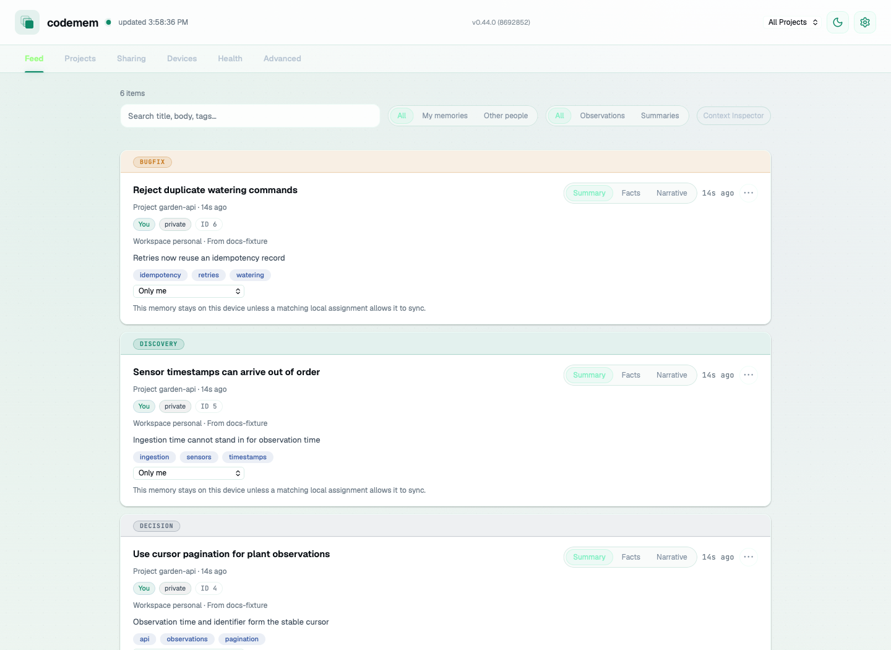
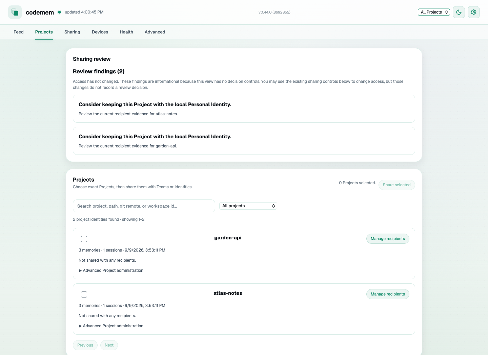

# User Guide

## Coordinator authentication and account-management upgrades

An older coordinator can keep serving ordinary device-signed sync while optional
auth reports `coordinator_auth_schema_upgrade_required`. The operator must pause
auth writers and back up the coordinator database before running
`codemem coordinator upgrade-auth-schema --db-path coordinator.sqlite --json`.
For D1, `codemem coordinator upgrade-auth-schema --export-sql` only prints the
reviewed SQL; apply it separately using the [controlled cutover](contracts/coordinator-auth-protocol.md#operator-cutover).
Never replay historical migrations on a deployment without a migration ledger.

Normal V2 linking needs no further upgrade. **Refresh profile**, **Unlink Google
account**, and later same- or different-account linking need the optional extension
on an intact V2 coordinator. Pause auth writers, drain pending attempts, back up the
database, and obtain separate approval before running either:

```fish
codemem coordinator upgrade-account-schema --db-path coordinator.sqlite
codemem coordinator upgrade-account-schema --export-sql --json
```

The local command changes only the selected existing database; the export applies
nothing. Run the exported statements in one atomic D1 binding batch only after the
separate approval; follow the [deployment guide](cloudflare-coordinator-deployment.md#optional-account-management-extension) for that apply and deployment.

Owner-resolution receipt storage is a separate, explicit extension that requires
the current account-management schema first. After pausing auth writers, draining
pending attempts, making a backup and obtaining separate approval, an operator can
install it on an existing regular SQLite file:

```fish
codemem coordinator upgrade-account-schema --owner-resolution --db-path 'coordinator.sqlite'
codemem coordinator upgrade-account-schema --owner-resolution --export-sql --json
```

This mode installs empty, immutable receipt storage only: it does not resolve an
owner, change access or provide a recovery UI. It rejects partial or unknown receipt
schemas instead of repairing them. The command does not pause writers, drain attempts
or make a backup; `--export-sql` opens no database and applies nothing, even when
`CODEMEM_DB` is set. Export cannot be combined with a database path, and
`--owner-resolution` cannot be combined with `--device-unlink`.

For local apply, use a trusted maintenance account that owns the regular database
file and its containing folder. Group/world-writable files or folders, unsafe parent
locations and detected path or identity changes are rejected; inspect the file and
parent ownership/permissions before retrying. The command does not change permissions.
Keep all writers stopped and protect the database, SQLite companion files and parent
paths from changes throughout maintenance. Canonical-path and identity rechecks detect
observed replacements but do not prove which file descriptor SQLite opened or prevent
a hostile same-account swap-and-restore race, including in WAL mode. ACL and platform
limits require separate operator inspection; see the
[local maintenance requirements](cloudflare-coordinator-deployment.md#optional-owner-resolution-receipt-storage).

## Explore the viewer

The Feed shows captured memories in the same order used when packing context: the full title, narrative, then every fact. Cards open by default; use **Collapse memory** or **Expand memory** to hide or reveal content and supplemental provenance, and use search to narrow the list.

The viewer checks status every five seconds while visible and focused. Health's detailed statistics refresh automatically no more than once every 30 seconds; opening Health, returning focus, or requesting a refresh loads them immediately. While the viewer is visible but unfocused, tab data stops polling and lightweight status checks slow to every 30 seconds. Hiding the tab or opening Settings pauses regular polling.

<picture>
  <source media="(prefers-color-scheme: dark)" srcset="images/docs-feed-dark.png">
  
</picture>

Optionally, use **Projects** to review project-level information. This example uses synthetic fixture data: its two Sharing review findings are informational, show no recipients, and do not show a successful sharing or sync flow.

<picture>
  <source media="(prefers-color-scheme: dark)" srcset="images/docs-projects-dark.png">
  
</picture>

All screenshots use invented data. Maintainers can reproduce them with the [screenshot guide](docs-screenshots.md).

## Check for updates

Use the read-only release check to compare the running CLI with the latest npm release on its
installed channel. Stable versions use `latest`; prereleases use `alpha`, `beta`, or `rc`:

```fish
codemem update check
codemem update check --refresh
codemem update check --json
```

- Results are cached locally for six hours; `--refresh` bypasses a fresh cache.
- `--json` prints one channel-aware status object and uses a non-zero exit code when no validated fresh
  or stale status is available.
- Stale validated cache data remains clearly labeled and may provide guidance when the registry is
  unavailable.
- This command never installs or executes an update. Release installation remains outside this
  read-only check. For a pnpm-global CLI, it reports the exact paired
  `pnpm add -g codemem@<exact-version> @codemem/embeddings@<exact-version>` action. Path-based
  pnpm-global detection recognizes a canonical global virtual-store entry but does not prove mutable ownership. For a
  mise-managed CLI, it reports the exact global mise action; on Linux that action is
  `env ONNXRUNTIME_NODE_INSTALL=skip mise use -g npm:codemem@<exact-version>`.
- `codemem update install` is the separate, fail-closed installer. Proven npm-global installations
  retain the 24-hour first-seen delay and install exact matching `codemem` and
  `@codemem/embeddings` versions from the public npm registry. For pnpm-global installations, it
  first runs bounded, neutral-directory `pnpm root -g`, `pnpm bin -g`, and
  `pnpm list -g --depth 0 --json` queries without a shell. It accepts only pnpm 9–11's
  `<list-root>/node_modules` root or pnpm 12's `<list-root>` root. The registered Codemem path and
  resolved entry must agree before it installs with explicit default and `@codemem` registry pins; it then verifies exact registered
  package versions and the exact launcher from the reported pnpm bin directory. It never runs a pnpm build-approval
  command; pnpm 9 still runs install scripts by default, while newer releases apply their configured build-script policy. Before a mise mutation, the installer
  reads bounded JSON from `mise ls --current` and `mise ls --global`, requires the active source
  to match a global source under the user's home directory, and requires its canonical install path
  to own the running CLI entrypoint. System, unresolved, and ambiguous custom sources are refused. It then runs
  `mise use -g npm:codemem@<exact-version>` with inherited
  environment, public default and `@codemem` registries, and Linux's CPU-only ONNX setting. Mise
  writes that exact release into the primary global config, which may move a declaration from a
  user `conf.d` or recognized user-level `~/.config/mise.toml` source to `config.toml`. Verification re-reads global state and requires `version`
  or `requested_version` to match the target,
  then uses `mise exec -- codemem version` from outside the invoking project, avoiding stale `PATH`
  entries and project-local overrides. Both paths refresh release status and stay on the installed channel. It refuses npx, Docker, pinned,
  development, stale, cross-channel, downgrade, unsupported-channel, and unknown installations. Bare `codemem update`
  remains non-mutating. As with a
  manual npm install, npm runs the packages' installation scripts for native CPU dependencies.
- Mise and pnpm-global installations are never eligible for plugin background auto-install. Changing
  either global installation requires the direct `codemem update install` command or the reported
  manual action.

## Start or restart the viewer
- `codemem serve` runs the viewer in the foreground.
- `codemem serve start` runs it in the background.
- `codemem serve restart` restarts the background viewer.
- `codemem serve --background` still works as a deprecated alias for `codemem serve start`.

## Viewer trust model

- The viewer and its JSON APIs are designed for **localhost-only** use.
- codemem currently relies on loopback-origin checks and local-process assumptions, not a real login/session auth layer.
- Binding the viewer to `0.0.0.0`, putting it behind a reverse proxy, or exposing it through a tunnel can make local APIs reachable in ways the current trust model was not built for.
- Treat the viewer as a local tool. If you must expose it beyond loopback, add your own auth and network restrictions first.
- This warning applies to the viewer HTTP service, not the separate sync/coordinator listeners documented elsewhere.
- Viewer JavaScript and Lucide icons are bundled locally, so loading icons does not contact a CDN. Fonts may still load from Google Fonts.

## Check local operational status

`codemem status` is the local operational roll-up. It reports database readiness,
viewer state, sync, maintenance, semantic indexing, raw-event ingestion, and the
observer without changing configuration or stored data.

```fish
codemem status
codemem status --json
codemem status --db-path ./codemem.sqlite --config ./codemem.json
```

- `status` answers whether codemem can do useful local work; `stats` reports database inventory and usage.
- Collection is offline and local-only. It does not contact peers, coordinators, registries, update services, or non-loopback viewer hosts.
- A missing database is reported without creating it. Existing databases are opened read-only.
- With no viewer PID record, status probes the configured loopback viewer address; a malformed or non-loopback record reports `unknown` and is not fetched.
- Warnings and errors appear in the bounded `attention` list. A collected report exits `0` even when `ok` is false; collection failures exit `1`, and usage errors exit `2`.
- With `CODEMEM_EMBEDDING_DISABLED=1`, the semantic index reports `disabled` and adds no attention item: semantic search is off by choice and keyword search still works.
- Terminal raw-event and observer failures affect `ok` for 24 hours; use `codemem db raw-events-gate` for the detailed reliability window.
- Use `codemem sync status` or `codemem sync doctor`, `codemem maintenance status`, and `codemem db raw-events-status` for detailed subsystem diagnostics.

## Seeing UI changes
- The viewer UI is built from `packages/ui/` and served by `packages/viewer-server/`.
- Rebuild UI assets after frontend changes: `pnpm --filter @codemem/ui build`.
- Restart the viewer after updates: `codemem serve restart`.

## Getting started in the viewer
- New browser profiles show a non-blocking checklist in Feed until its five jobs are completed or skipped: capture a memory, inspect its details, find it again, choose project scope, and check Settings or Health.
- **Search memories** focuses the normal Feed search. **Find it again** completes after a successful search returns a visible result matching the query.
- Steps complete from real data and actions rather than manual checkboxes. Completion and dismissal stay in versioned browser-local storage for that viewer profile.
- **Skip getting started** hides the checklist without completing pending steps. Reopen it with **Show getting started** in Settings; completed steps remain completed.
- Empty Feed messages distinguish no data, queued processing, paused capture, unavailable processing status, search with no matches, and filters with no matches. Use the action in the message to clear the active constraint or open the existing recovery surface.

## Settings modal
- Open via the Settings button in the header.
- Shows effective values (configured or default) to avoid blank/ambiguous fields.
- Persists only changed settings on save (unchanged effective defaults are not rewritten to config).
- Each editable field states which stage and scope it affects, when the change takes effect, and whether existing data is reprocessed. Fields show the viewer's current effective values; environment-managed values remain identified as overrides.
- Uses task-oriented sections: `Connection`, `Processing`, and `Device Sync`.
- Includes a `Show advanced controls` toggle for technical tuning fields (JSON headers, cache/timeout, tier-routing tuning, network overrides, and pack limits).
- Connection/auth settings map to `claude_command`, `observer_runtime`, `observer_provider`, `observer_model`, `observer_base_url`, `observer_auth_source`, `observer_auth_file`, `observer_auth_command`, `observer_auth_timeout_ms`, `observer_auth_cache_ttl_s`, and `observer_headers`.
- Processing settings include `raw_events_sweeper_interval_s` plus tiered observer routing controls for `observer_tier_routing_enabled`, `observer_simple_model`, `observer_simple_temperature`, `observer_reasoning_effort`, `observer_reasoning_summary`, `observer_rich_model`, `observer_rich_temperature`, `observer_rich_reasoning_effort`, `observer_rich_reasoning_summary`, and `observer_rich_max_output_tokens`.
- Settings keeps connection choice and model choice together on the Connection tab. With tiered routing on, Simple and Rich are the main model fields; `observer_model` appears only as an optional advanced or already-configured fallback. With tiered routing off, `observer_model` is the main model field.
- When you change the connection, provider, base model, or authentication method, Settings saves the displayed routing switch with the change so your Simple and Rich choices stay in effect. Unrelated saves leave automatic routing unchanged.
- Settings outcomes honor `CODEMEM_OBSERVER_SIMPLE_PROVIDER` and `CODEMEM_OBSERVER_RICH_PROVIDER` over saved tier providers. Empty overrides clear the saved tier provider; temperature and base-model outcomes follow the resulting tier-provider fallback.
- Observer environment overrides follow the runtime's parsing rules in Settings and save results: empty strings clear string fields, clear authentication commands/headers, set temperatures and output-token limits to zero, and disable boolean options. Empty or invalid integer and output-mode overrides, and empty sidecar-command overrides, retain saved values and do not mark those settings as environment-controlled.
- When you have not made an explicit routing choice, codemem may enable tiered routing automatically for capability-safe paths such as OpenAI/Anthropic over `api_http` and Claude subscription usage over `claude_sidecar`.
- The base-model outcome describes only requests that actually use that model: omitted routing/provider fields can resolve automatically, even when the form shows an unchecked routing switch. Explicit `false` disables routing; custom API endpoints and Codex sessions do not auto-enable it. Claude tiers use built-in model defaults. Codex tiers preserve explicit tier or base models; without either, they use `gpt-6-luna` for simple batches and `gpt-5.6-terra` for rich batches.
- Explicit routing, model, and reasoning settings take precedence over built-in defaults where the selected transport supports them. OpenAI transport behavior has the simple-tier exception described below.
- OpenAI tier routing defaults to `gpt-6-luna` for simple batches and `gpt-5.6-terra` for rich batches.
- Rich routing defaults to 12,000 output tokens, while an explicit global `observer_max_output_tokens` setting or benchmark `--max-output-tokens` override applies to both tiers; `observer_rich_max_output_tokens` remains the highest-priority rich-only override.
- Official OpenAI direct API tiers always use Responses and explicitly send reasoning effort `medium` unless you configure a different effort. OAuth `codex_consumer` requests also remain on Responses. `observer_openai_use_responses: false` is only a custom-gateway compatibility setting: it selects chat completions when `observer_base_url` explicitly points to an OpenAI-compatible gateway, and official OpenAI cannot opt out of Responses. Chat-completions requests do not report reasoning effort or summary because those controls are not transmitted.
- When explicit tier routing keeps the same custom provider, both tiers preserve its `observer_openai_use_responses` setting. Set it to `true` for a Responses-only gateway; changing the tier provider does not carry the base provider's protocol choice to a different custom provider.
- When tier routing uses a custom provider whose gateway rejects `temperature`, set `observer_temperature`, `observer_simple_temperature`, and `observer_rich_temperature` to JSON `null` in your config file to use model defaults without changing models, authentication, or protocol. Null tier temperatures inherit the global temperature; omitting the global setting still defaults to `0.2`, and numeric temperature environment overrides take precedence.
- Observer output defaults to `legacy_xml` during the compatibility rollout. Set `observer_output_mode` or `CODEMEM_OBSERVER_OUTPUT_MODE` to `auto` to use a validated JSON envelope on official OpenAI Responses and direct Anthropic API-key paths while keeping sidecars, OAuth consumers, and unknown gateways on XML; use `json_schema` only when explicitly enabling a compatible custom gateway.
- `json_schema` is an operator assertion that a custom OpenAI gateway configured through `observer_base_url`, or an Anthropic gateway configured through `CODEMEM_ANTHROPIC_ENDPOINT`, implements its provider's required JSON Schema contract. Codemem does not probe or infer this support from the gateway name. A refusal, truncation, missing response, invalid JSON, or locally invalid envelope fails closed and leaves existing raw-event retry behavior in control; Codemem does not reinterpret malformed constrained output as XML.
- Codemem defines a provider-neutral forced `record_memories` tool using the same envelope and rejects anything other than one valid call. This transport is not enabled for any provider/runtime cell yet; sidecars, OAuth consumers, and other unproven paths stay on XML until executable contract tests exist.
- XML will remain available until measured fallback use is negligible over a bounded rollout window and every supported access path has a tested contract. Removing the XML prompt, parser, and repair call requires a later compatibility-breaking release with release notes.
- Legacy XML responses larger than 1,048,576 UTF-16 code units fail with `observer_output_too_large` before parsing, including repair responses. Codemem never truncates the output to keep only some memories; existing raw-event retry rules handle the failed call. This ceiling matches the SSE buffer limit and is separate from the observer transcript input budget.
- OpenAI Responses requests omit temperature whenever active reasoning is configured because GPT-5.1+ accepts sampling controls only with reasoning effort `none`; replay and benchmark metadata report that temperature as not transmitted.
- Configure reasoning shared by both OpenAI Responses tiers with the Processing tab's advanced `Shared reasoning defaults`, the global `observer_reasoning_effort` / `observer_reasoning_summary` file settings, or their `CODEMEM_OBSERVER_REASONING_*` environment variables. The `observer_rich_reasoning_*` settings remain optional rich-specific overrides.
- The 2026-08-07 list rates are Luna at $1.00/M input and $6.00/M output versus GPT-5.4-mini at $0.75/M input and $4.50/M output; Terra and GPT-5.4 are both $2.50/M input and $15.00/M output. Measured extraction cost can rise by more than the list-rate difference when a model produces more output tokens.
- If a selected tier path cannot honor the requested settings, codemem records the requested versus actual provider/model/runtime details and surfaces a visible fallback reason.
- Sync settings can also be updated here (`sync_enabled`, `sync_host`, `sync_port`, `sync_interval_s`, `sync_mdns`).
- Environment variables still override file values.
- Connection mode and its outcome labels use the backend's resolved observer runtime, including automatic Claude/Codex session detection and normalized environment values. An explicit mode edit previews the saved choice unless an environment override controls it; reading Settings does not start a model request or authenticate a client.
- Connection mode appears before Model provider in Settings. Local Claude and Codex sessions choose their own provider, so Settings hides the provider picker in those modes; the saved provider choice remains available when switching back to automatic mode.
- The provider picker includes OpenAI, Anthropic, OpenCode, and configured custom providers. The running connection status hides the separate API-key and saved-sign-in inventory for local CLI sessions and OpenCode accounts; that inventory does not describe those connections.
- Explicit choices are **OpenCode account**, **API key**, **Local Claude session**, and **Local Codex session**. API-key mode never uses a cached subscription sign-in or falls back to OpenCode. OpenCode-account mode uses only the running OpenCode service, regardless of which client captured the activity. Existing automatic connections keep their current rules until changed. An unavailable selected connection produces an observer error, not a switch to another account.
- Blank model fields show backend defaults as placeholder text, including the selected connection's Simple and Rich models. Placeholders are not saved as explicit overrides. Settings highlights **Restart required** before saving only when edits affect settings the server cannot apply live; reverting those edits removes the warning. Observer changes apply live when supported, and save results remain authoritative if applying fails.
- With automatic Connection mode, changing Authentication source previews the mode that will apply after saving, including switching from Codex to API for command/file authentication and back when restored. The config API returns `observer_runtime_by_auth_source` alongside `resolved_observer_runtime`; these safe previews use the same resolver and server-side dependencies as runtime selection. Unrelated edits preserve an omitted runtime setting rather than saving the displayed automatic mode.
- Saving observer settings pauses new extraction, waits for already-dispatched work, and applies the new runtime and tier models without restarting the viewer when live apply is available. The save result reports whether changes are applying or a restart is required instead of showing restart guesses under each observer field. Settings shows the running observer separately from saved values while the change applies. If it cannot apply, captured events stay queued; reopen Settings and choose **Retry applying observer settings**. A listed model is not proof that the active provider account can use it; check observer diagnostics after a request. The connection choice is still global to this viewer database, not per Project.
- Config resolution supports JSON and JSONC with this precedence:
  1. explicit `CODEMEM_CONFIG`
  2. workspace-scoped config derived from `CODEMEM_RUNTIME_ROOT` or `CODEMEM_WORKSPACE_ID`
  3. legacy global config (`~/.config/codemem/config.json` or `~/.config/codemem/config.jsonc`)

## Extraction replay and benchmarks

Proven delegated brief-only batches produce a context-only outcome instead of an
observer evaluation. `memory extraction-replay --json` returns
`status: "context_only"`, `code: "delegated_brief_context_only"`, `evaluated: false`,
the batch/scenario IDs and an explanatory message, with exit status zero.

`memory extraction-benchmark` continues past context-only batches and records each
skipped iteration in `summary.contextOnlySkips`. `summary.contextOnlySkipped` counts
those skips, while `summary.scheduledTotal` counts every scheduled batch/iteration.
`summary.total`, `runs`, failure counts and quality, stability, output, cost and
latency metrics cover actual observer attempts only; an all-context-only benchmark
has no evaluated runs and null rates, rather than a quality pass.

## Observer auth configuration

- Explicit runtime choices are `api_key`, `opencode_v2` (OpenCode account), `claude_sidecar`, and `codex_sidecar`. `api_http` remains supported for existing automatic setups.
- Pi observer auto-derivation is API-key-only. `codemem setup` can derive unset `observer_provider` / `observer_model` from pi API-key providers (cheap-model-first) without copying secrets. `unconfigured (oauth-only)` is an auto-derivation status, not the state of every observer connection. Configure observer credentials or the connection separately, with provider or model overrides as needed.
- `claude_sidecar` runs observer calls through the local Claude runtime (subscription/session auth) and does not require `ANTHROPIC_API_KEY`.
- `claude_command` controls how `claude_sidecar` invokes Claude CLI (default `["claude"]`).
  - Wrapper example: `"claude_command": ["wrapper", "claude", "--"]`
- `codex_sidecar` runs observer calls through the local Codex CLI login and does not require `OPENAI_API_KEY`.
- OpenCode keeps refreshed provider credentials in its service database, not the legacy `auth.json` file. Select **OpenCode account** (`opencode_v2`) to use that connection, **API key** (`api_key`) for a separate API credential, or `codex_sidecar` for a local Codex CLI login. Codemem does not copy credentials out of OpenCode's database.
- When observer authentication is missing or rejected, new raw-event batches stay visibly failed and retryable without spending flush attempts or advancing their stream cursor. The sweeper backs off until credentials become available.
- Once authentication works again, the viewer automatically reviews retained raw events from older auth-missing failures whose cursors already advanced. It reconciles overlapping failed ranges, excludes completed ranges, and limits non-no-op recovery attempts to four per hour. Windows containing only assistant usage records complete without an observer call, a budget charge, or a new memory; the raw records remain intact. Recovered observations keep their original event time, remain private on this device, and do not replace later session summaries. Missing or invalid raw events stay failed for review instead of receiving invented facts. Set `CODEMEM_RAW_EVENTS_RECOVERY_ENABLED=0` on the viewer process to disable automatic historical recovery.
- `codex_command` controls how `codex_sidecar` invokes Codex CLI (default `["codex"]`).
- Default model selection:
- `api_http`: `gpt-6-luna` for OpenAI unless `observer_model` is set.
- `claude_sidecar`: `claude-4.5-haiku` unless `observer_model` is set.
- `codex_sidecar`: `gpt-6-luna` unless `observer_model` is set; with tier routing enabled, the rich default is `gpt-5.6-terra` unless an explicit base or rich model is set.
- Tier routing may pick different simple/rich models automatically when the current runtime/provider path is marked capability-safe.
- Anthropic direct API calls use Anthropic's direct model IDs. codemem translates the common shorthand `claude-4.5-haiku` to `claude-haiku-4-5`; if you want a fixed snapshot, set a versioned model like `claude-haiku-4-5-20251001` directly.
- If a configured `observer_model` is unsupported by a sidecar CLI, codemem retries once with that CLI's default model.
- Supported auth sources: `auto`, `env`, `file`, `command`, `none`.
- Endpoint and credential always come from the same source: vendor-scoped env/OAuth credentials (`OPENAI_API_KEY`, `ANTHROPIC_API_KEY`, `OPENCODE_API_KEY`, `CODEX_API_KEY`, Anthropic OAuth) are only sent to the official provider endpoint. A custom `observer_base_url` or pi-derived gateway authenticates via `CODEMEM_OBSERVER_API_KEY`, `observer_api_key`, an OpenCode provider block's own key, or the endpoint-matched pi credential — never a vendor key.
- `observer_auth_command` is argv and must be a JSON string array, not a space-separated string.
  - Config file form: `"observer_auth_command": ["iap-auth", "--audience", "example"]`
  - Env var form (`CODEMEM_OBSERVER_AUTH_COMMAND`): `'["iap-auth","--audience","example"]'`
- Header templates can use `${auth.token}`, `${auth.type}`, and `${auth.source}`.
- Settings are grouped into `Connection`, `Processing`, and `Device Sync` sections with shell-agnostic labels.
- Queue settings include `raw_events_sweeper_interval_s` (seconds), which controls background pending-event drain cadence.
- Tiered routing and simple/rich model choices live in the Connection tab. Processing retains background cadence and advanced request tuning; the optional base fallback is shown only when already configured or when advanced controls are visible.
- Rich-tier OpenAI transport tuning remains visible in Processing. Official OpenAI tiers and OAuth `codex_consumer` always use Responses with reasoning effort `medium` by default. An explicit custom `observer_base_url` may use `observer_openai_use_responses: false` for chat-completions compatibility.

Example command-token gateway config:

```json
{
  "observer_provider": "your-gateway-provider",
  "observer_base_url": "https://gateway.example/v1",
  "observer_runtime": "api_http",
  "observer_auth_source": "command",
  "observer_auth_command": ["iap-auth", "--audience", "example"],
  "observer_auth_timeout_ms": 1500,
  "observer_auth_cache_ttl_s": 300,
  "observer_headers": {
    "Authorization": "Bearer ${auth.token}",
    "X-Auth-Source": "${auth.source}"
  }
}
```

Header template variables:

- `${auth.token}`
- `${auth.type}`
- `${auth.source}`

Command/file token caching notes:

- Successful `file`/`command` token resolutions are cached for `observer_auth_cache_ttl_s`.
- Failed `file`/`command` resolutions are not cached (codemem clears stale cache and retries on the next call).

## Memory persistence
- A session is created per ingest payload.
- Observations and summaries persist when the observer emits meaningful content.
- Low-signal observations are filtered before writing.

## Automatic context injection
- The OpenCode 1 plugin injects a memory pack next to the latest user message by default, keeping older prompt prefixes stable for provider prompt caches.
- The OpenCode 2 entrypoint (beta integration, validated on the exact stable OpenCode 2.0.24 release) captures activity, manages lifecycle cleanup, and exposes manual `mem-status`, `mem-recent`, and `mem-stats` tools through `tool.transform` with `codemode: false`. On OpenCode 2.0.24, automatic recall runs through `session.context` when the latest user message has a non-empty ID. Each identified turn performs one fresh retrieval, while retries and tool continuations replay retained context; missing or blank identity skips safely. Auxiliary hooks remain isolated; see the [pinned contract](opencode-v2-contract.md). To stop the OpenCode 2 path or return to OpenCode 1.18.29+, follow [troubleshooting and rollback](plugin-reference.md#opencode-host-support-troubleshooting-and-rollback); no database migration is needed.
- OpenCode 1 controls:
  - `CODEMEM_INJECT_CONTEXT=0` disables injection.
  - `CODEMEM_INJECT_SURFACE=system` uses the legacy OpenCode system-prompt injection surface.
  - `CODEMEM_INJECT_LIMIT` caps memory items (default 8).
  - `CODEMEM_INJECT_TOKEN_BUDGET` sets a positive approximate cap for OpenCode's complete wrapped injection (default 800). Unset, zero, negative, and invalid values use the default. OpenCode reserves its context prefix before requesting the pack; an override too small to leave a positive pack budget injects nothing because `0` means unlimited to generic pack calls. Accounting uses `ceil(characters / 4)`, not the provider tokenizer.
- Scope revocation affects newly built packs immediately, but already-injected context in the current OpenCode session is not retroactively scrubbed; start a new session after revoking access if you need a clean prompt history.
- Automatic message recall has an optional retained ceiling (`CODEMEM_INJECT_RETAINED_TOKEN_BUDGET`), off by default; set a positive integer such as `8000` to opt in. The per-pack default remains 800. Existing blocks are never truncated or rewritten, even after restart or when the ceiling is lowered. Actual removal from ordinary transform history releases allowance; compaction notification alone does not. The system surface remains per-pack only. See [lifecycle details](opencode-retained-recall.md).
- Expand **Automatic recall (advanced)** in Health for local duplicate hit rates, estimated injection tokens avoided, and metadata gaps. The panel covers at most the newest 1,000 eligible retrieval attempts in the last 30 days across all projects, with current memory visibility enforced. Older clients or failed capture leave savings unknown, not zero; the estimates are not provider costs.
- Retrieval, skipped injection after attempt creation, current-request cache reuse, and handoff status are recorded in the local evidence ledger. A positive token budget too small for the context prefix is rejected before an evidence-ledger attempt is recorded and reported once through the plugin's warning logs. Records contain bounded memory identity, diagnostic codes, and safe repository-relative working-set paths, never prompt text, pack text, memory content, or absolute paths. Reattaching historical cached context does not create attempts, and ledger failures do not block injection. If post-restart identity repair fails, usable fallback context is still injected without assigning its delivery to a stale or failed ledger attempt.
- Reuse savings estimate discovery work versus pack read size.
- Automatic message recall deduplicates unchanged retained item fingerprints. Narrow continuation prompts skip injection only after retrieval confirms no changed facts and file/tool context is unchanged. When local plugin logging is enabled, `inject.recall` JSON separates new and retained estimated tokens, duplicate counts, and bounded reasons without content or identifiers. See [lifecycle and evaluation details](opencode-retained-recall.md); these estimates do not measure answer usefulness or provider token usage.

### Pi

Pi captures session, message, and tool activity through `@codemem/pi-extension`. Automatic recall appends a block to the latest user message of the request copy. Older messages replay that process's in-memory decision only; `session_start` and a restart clear it, and the next turn fetches again. The system prompt and saved transcript are not changed. A successful built-in `read` can also attach file context to that tool result.

- `CODEMEM_PI_INJECT_PROMPTS=0` disables prompt recall. If that variable is unset, `CODEMEM_INJECT_CONTEXT=0` does the same for Pi prompts.
- `CODEMEM_PI_FILE_CONTEXT=0` disables read-file context. It is independent of prompt recall.
- `pi.tools_mode` / `CODEMEM_PI_TOOLS_MODE`: `native` (default) registers 14 native tools; `mcp-adapter` skips native registration so an independently configured MCP surface can supply them. Use one surface.
- Pre-install history is not imported automatically. Run `codemem pi-import-sessions` to backfill it. `--extract` also runs the observer over pending Pi sessions, so model cost scales with the backlog; without it, this command does not run extraction. Import `--json` also reports whether extraction was requested, flushed-event and failed/pending-session counts, and the first extraction error. Incomplete extraction exits with code 1 while keeping imported events.
- Search stored user/assistant text with `codemem pi-session-search <query>`. `--json` returns the shared core response, including `query_truncated` when matching uses a bounded prefix of the query. Human output warns about partial matching even with zero results; shorten the query and retry. See [session search and history import](plugin-reference.md#session-search-and-history-import) for flags and import safety limits.

Settings: [Pi extension](plugin-reference.md#pi-extension) and the [package configuration table](../packages/pi-extension/README.md#configuration).

### Usage metric semantics

`codemem stats --json` and the viewer usage API identify token units and provenance. Pack rows are estimates of tokens injected into context. Observer rows use provider-reported input tokens (`tokens_read`) and output tokens (`tokens_written`) across every attempted observer call; transports without usage telemetry record those values as unavailable instead of estimating them.

Observer rows written before this provenance marker used UTF-16 text lengths, not tokens. Codemem keeps those rows for audit but excludes their values from token aggregates and reports them through `legacy_text_length_count`; the original token counts cannot be recovered. Health’s Injected, Savings, and Reduction cards use pack estimates only, so observer model usage is not mixed into pack-size metrics.

The viewer may cache global usage totals, but it checks recent memory packs against current permissions on every request. If a pack references hidden, missing, deleted, or invalid memories, it keeps permitted memory IDs and omits other metadata, including summaries and snippets. Fully visible packs retain their metadata.

## Retrieval attribution diagnostics

Use `codemem stats --attribution` to inspect local, bounded, observational retrieval diagnostics:

```fish
codemem stats --attribution
codemem stats --json --attribution
```

- The report covers the 50 most recent retrieval attempts and at most 100 linked assessments; counts are a recent bounded window, not lifetime totals.
- It includes lifecycle completeness: requested, selected, and handed-off attempts and exposures.
- Evidence completeness distinguishes validated assessed attempts with known or unknown results (insufficient evidence) from unassessed attempts (no valid assessment row was inspected).
- Invalid rows failed current fail-closed validation. Omitted-by-limit rows exceeded the assessment cap; affected attempts are reported with indeterminate status or incomplete assessment details instead of inferred from unvalidated raw rows.
- Findings include counts of stale and harmful assessments.
- It contains no raw transcript, per-memory ROI, or composite productivity score. It makes no causal claim absent a preregistered randomized contrast.

## Semantic recall

Codemem combines FTS5 keyword retrieval with sqlite-vec semantic retrieval.
Embeddings are written for new memories, and semantic ranking for a file-backed
database runs in one local worker. `memory_search` and `memory_pack` keep their
existing result formats; packs can combine keyword and semantic evidence.

### Upgrade an existing database

The first opening of an existing file-backed database with embeddings enabled
upgrades the vector layout automatically, before it serves requests. The upgrade
copies vectors in one transaction and preserves existing memories and vector
identities. It may take time and requires temporary disk space roughly comparable
to the vector tables.

1. Stop or close every other Codemem writer using that database.
2. Start the updated Codemem runtime and open the database normally.
3. Wait for the initial open to finish before sending requests.

If the database is busy, Codemem fails without changing the older layout. Close
the other writers and reopen it. A failed upgrade rolls back, so the legacy
layout remains usable. Do not remove vector tables or try to downgrade the
database manually.

After the upgrade, update every process that writes the database before using
semantic retrieval. Older runtimes can still use keyword access only when
embeddings are disabled; they cannot use semantic features with the upgraded
layout. There is no automatic downgrade.

### Use keyword-only retrieval

Set `CODEMEM_EMBEDDING_DISABLED=1` before starting Codemem to skip the upgrade
and semantic retrieval. Keyword search continues to work. This is useful when
you need to keep an older runtime on the database temporarily.

Semantic results use only validated vectors. A model change or rebuild can
temporarily return keyword-only results while Codemem finishes validation.
After that audit, valid rows remain searchable even when other stored vectors
need repair.

Cleanup removes vectors with invalid numeric values or unusable metadata,
without changing source memories. Rows from undeclared models remain available
for a later model transition. Use `codemem embed --dry-run`, then `codemem embed`,
to backfill missing vectors.

For applications that create a `MemoryStore`, close an asynchronous semantic
store before closing its database:

```ts
const store = new MemoryStore("./codemem.sqlite");

try {
  // Use the store.
} finally {
  await store.closeAsync();
}
```

`closeAsync()` waits for queued semantic work and background vector work before
SQLite closes. `close()` remains synchronous when no semantic or audit work needs
draining; it cancels unfinished best-effort vector writes. Use `closeAsync()` to
flush those writes. A store that owns a semantic worker requires `closeAsync()`.

## Distill recurring lessons

Use `codemem distill` to find lessons that keep showing up in memory history.

```fish
codemem distill --explain
codemem distill --all-projects --json
codemem distill --no-judge       # skip the observer-model worthiness judgment
codemem distill --draft          # draft an AGENTS.md rule for the top candidate + diff
codemem distill --draft --apply  # write it after confirmation
```

Candidate mining is deterministic and review-first:

- `project` candidates target that repo's `AGENTS.md`; `user` candidates target global/user context.
- Without `--draft`, the command only emits ranked candidates and evidence (`draft_text` is null).
- Candidates are judged by default: one short observer-model call per candidate drops clusters that are recurring *activity* (release/CI status, review passes with no findings, context lookups) rather than recurring *lessons* — recurrence alone cannot tell these apart. Unjudgeable candidates are kept and marked `unjudged`. When no observer model is configured, the command falls back to unjudged output with a warning; `--no-judge` skips the judgment (and its model calls) entirely.
- `--draft` uses your configured observer model to write one concise rule for the top candidate and prints a unified diff; it does not write anything.
- `--apply` (implies `--draft`) writes the rule into a codemem-managed `## Distilled lessons` block, delimited by `<!-- codemem:distilled:begin/end -->` markers so every distilled edit stays in one place. It prompts before writing (except with `--json`, which is non-interactive — there `--apply` itself is the explicit consent and the write happens immediately) and appends only (never deletes your existing notes).

## Projects, Sharing, Devices, and Health

For the short Project-first walkthrough, see [Share Projects and add devices](sharing-guide.md).

### Link a Google account

The **My Account** card at the top of **Sharing** is separate from sharing controls. When the coordinator confirms that the Google account is linked to the current Codemem Identity, the verified Google name and email identify that same Identity in **Sharing → Identities** and in Team member lists. The local Identity ID remains under **Technical details**. This changes only how the Identity is presented; it does not rename or replace the stored Identity or change its devices, Teams, or Project access.

Identity, device, and coordinator information is collapsed under **Technical details**; **Link Google account** is hidden when the coordinator reports a linked account, while **Check status** remains available.

This card is available from the current source checkout or a release that includes My Account. It is not available in every installed version. Account status is per coordinator. If more than one coordinator group is configured, the Viewer checks status with the first group whose enrollment the coordinator accepts. To use a specific group instead, choose it under **Technical details**. The card does not accept an arbitrary profile, URL, or identifier.

To link an account:

1. Open the Viewer on the device whose existing Identity you want to link, then choose **Link Google account**.
2. Complete Google sign-in in the browser window that opens. If the browser blocks the window, choose **Open Google sign-in** to open it on the same computer.
3. Return to the Viewer. Status updates automatically while linking; after the attempt finishes, **Check status** is available to verify the result. The coordinator's signed account status is the completion record.

The card starts Google sign-in only when you choose **Link Google account**. Do not paste a private sign-in link into another browser or computer.

The Viewer and browser must run on the same computer. Account linking requires the Viewer to bind to `localhost`, `127.0.0.1`, or `::1`; wildcard bindings do not expose the account API. An SSH tunnel can show Viewer status on another computer, but its loopback callback reaches that other computer, so linking is unsupported there. Do not copy private sign-in links or use an SSH workaround.

The coordinator must support the signed account-status endpoint and have Google browser authentication enabled. A self-hosted operator performs any required coordinator upgrade and deployment separately; this client flow does not change coordinator schema. An older coordinator that returns unsupported is not asking for Google; the card cannot start linking against it. An unavailable or unknown status does not mean the Identity is unlinked—check status again.

For an active enrolled device with a current Identity that matches coordinator eligibility, choose **Link Google account**, complete Google sign-in, and return to the Viewer. This normal flow needs no administrator credential, review command, enrollment, claim checkbox, or new Identity.

Linking applies only to the current Identity. It does not change device keys, enrollment, grants, or history, and it cannot authorize another device. If the coordinator cannot link the eligible context, ask its operator; do not reset a profile, create an Identity, or use an administrator credential in the Viewer.

Account linking is optional. It does not grant Team or Project access, move an Identity, merge accounts, reassign devices, transfer history, or change existing device keys or enrollments. At one coordinator, one Google account links to one existing Identity, and each Identity links to one account. Choose an account that follows your work policy.

When the coordinator advertises account-management capability, a linked account can show **Refresh profile** and **Unlink Google account**. **Check status** only reads the signed coordinator result; it does not refresh a profile. Refresh requires fresh Google proof and has no extra confirmation.

Unlink asks once in the Viewer and uses this device’s existing authorization; it does not open Google sign-in or another tab. Cancel leaves the account unchanged. Confirming ends the current link, its browser sessions and display profile, while preserving your Identity, device keys, history, memberships and access grants. To link again—whether to the same or another Google account—choose **Link Google account** (or **Sign in with Google**) and complete Google verification. Unlinking never switches this device to another Identity.

If this device runs as a different Identity than the account owner the coordinator confirmed, the card names both and does not show the owner's Google profile. Refresh and Unlink work only on a device that runs as the account owner; **Sign in with Google** can switch this device to the owner (see below).

Google account details (name, email, and picture) appear only on a device that holds its own proof for the Identity: the device that linked the account, one with its own controller attestation, or one that signed in with Google. Another device of the same Identity shows **Linked on another device** without those details, and offers **Sign in with Google** so it can refresh or unlink the account too.

If these controls are absent, management is not currently available for this device and coordinator. Check status before retrying; do not use an external Google workaround or an operator credential.

If the coordinator reports an Identity mismatch, conflict, revoked link, or required review, ask the coordinator operator to resolve it; the card does not merge or repair identities.

Use **Cancel linking** to ask to stop an in-progress request. Status updates continue if the cancellation request fails. An unknown outcome can still finish later; use **Check status** when it becomes available.

If the Viewer configuration changes during an attempt, **Cancel previous link** requests cancellation for the original Identity; it does not attach that attempt to the newly displayed Identity. Transient status failures retry until the attempt's deadline without reopening sign-in. After that deadline, use the available cancellation and status controls to check the outcome.

Returning to the tab or refreshing resumes an in-progress operation. Restarting the Viewer loses its in-memory operation, but **Check status** still reads the signed coordinator result. The linking request has a ten-minute deadline. Local capture, reading, and direct sync continue without Google, and this optional link does not add a required-auth policy.

### Sign in with Google on a device

Starting in 0.47.0, a Viewer whose coordinator supports it shows **Sign in with Google**
instead of **Link Google account**. Signing in sets this device's Identity from your
Google account:

- **The account is linked to another Identity.** The browser shows both Identities
  and the Teams this device would stop syncing with, and asks you to confirm. This
  device then switches to your account's Identity. It gets only the Teams and
  Projects that Identity already has; memberships and Project grants never move, and
  memories keep their original author.
- **The account is linked to this device's Identity on another device.** Confirming
  gives this device its own proof, so it can refresh or unlink the account too. Its
  Identity stays the same.
- **The account isn't linked yet.** Choose **Link this account** to link it to this
  device's current Identity, as in [Link a Google account](#link-a-google-account).

Each device can switch or bind this way only once. If the result is unclear, for
example after a network failure, restart the Viewer and check status before trying
again; the Viewer resolves an unfinished switch by reading coordinator status.
Devices that hand out Project access learn about the switch from the coordinator
once they run 0.47.0, and keep sharing whatever the new Identity is allowed to see.

### Repair a reviewed account owner

This recovery workflow first shipped in **0.47.0-beta.4**. It works only against a
coordinator that its operator has upgraded for owner resolution, and that coordinator
upgrade and live rollout are separate operator steps.

When available, **Review account ownership** appears in **My Account** only for a
review-required, conflicting, or mismatched account state. It does not use the
computer username or create a new Identity.

This state often follows an upgrade from the older model, where each install created
its own Identity. Each machine then claimed your other devices under its own ID, so
different Teams can record different owners for the same device. With operator access,
the owner list suggests every Identity that a Team records for this device and names
the groups that record it. Pick the Identity that is linked to your Google account. If
no owner is recorded, the dialog opens **Advanced: enter an existing owner ID** so you
can enter that Identity ID directly.

1. Choose **Review account ownership**, select the already-linked existing owner and
   each group to review, then choose **Preview account ownership**.
2. Inspect every retained assignment and each group result. The preview keeps the
   full retained history. Reviewed weak labels, including Project actor labels, are
   display-only account-owner evidence, not device assignments or sharing access.
3. An operator-configured Viewer shows an unchecked acknowledgement by default. Check
   it only after reviewing the current preview, then choose **Confirm account ownership**.
   While any selected group is blocked, the acknowledgement stays disabled and the
   dialog names the blocked groups. Clear those groups or fix them, then preview again.
   The coordinator requires a fresh scoped review and confirmation; an ordinary
   controller-only approval is not enough.
4. Read each group result separately. **Check review status** is read-only and never
   applies a review again. For a missing, unknown, stale, wrong-profile, wrong-group,
   or wrong-target result, request a fresh preview and acknowledgement instead of retrying
   an old confirmation.

A new preview replaces the previous results. A preview expires after 5 minutes, and the
Viewer runs one ownership request at a time, so another tab waits while one confirms.
When **Confirm account ownership** is disabled, the dialog says why below the button.
Owner reviews wait at least 10 seconds for the coordinator, or longer when
`sync_coordinator_timeout_s` is higher.

Confirming saves the owner under `~/.codemem/account-owner-associations`. Codemem
refuses to save it while `~/.codemem` is writable by your group or other users, and the
dialog shows the command that fixes it, usually `chmod go-w ~/.codemem`. Some managed
workspaces create that folder group-writable.

The confirmed account owner is displayed separately from the unchanged Memory author
and sharing Identity. The workflow retains old records, memories, keys, configuration,
services, sharing grants, and their full history. It is not an actor merge, reset,
Google-account move, new Identity, Team/Project permission change, or future-policy
setup. Existing Team and Project delivery or reconciliation warnings still need their
own sharing review.

After approval, **My Account** says which Identity this device runs as and who owns
the account. It does not show the owner's Google name, email, or picture, because this
device never signed in as the owner. The owner projection does not enable linking,
profile refresh, unlink, disconnect, or permission changes.

If the recovered owner has a Google link, choose **Sign in with Google** to run this
device as that Identity. This starts a separate sign-in, not another owner review.
The coordinator checks the device, and Google sign-in and your confirmation are still
required before the device switches. Existing memories keep their original author.

Without an operator-configured Viewer, use the dialog's **Copy support request** and
send the noncredential request only to a trusted coordinator operator, never a public
issue. It includes private coordinator, device, and group identifiers but no admin
secret or private key. Paste only that operator's noncredential JSON reply and choose
**Verify operator reply**. The local backend checks fresh device-signed receipt and
owner proof before retaining an association; a verified import can restore that local
association while immutable history remains unchanged. Use the local Viewer with
your browser for the supported requester flow; do not bypass its loopback,
Host/Origin, or CSRF protections with ad hoc console or SSH instructions.

### Choose a sharing flow

The normal flow is **Projects → Sharing → Devices → Health**, not manual pairing. Inside **Sharing**, open **Teams** when you want to manage ongoing Team membership and inherited Project access:

- **Team onboarding** — create or join a Team when people will collaborate over time.
  - Accepting the Team invitation links the recipient's Identity and device and inherits every current and future Project assigned to that Team.
  - The invitation does not create Project-to-Team assignments. Manage those separately, and review the Team's Projects before sending or accepting the invitation.
  - Team invitation previews group matching Project display names into one row, combine their memory counts, and show how many distinct Project identities the row covers. This summary does not merge Project identities or change access; matching names alone do not prove that repositories are the same.
- **Direct Project sharing** — once Team sharing is configured, use **Share exact Projects** to invite one Identity to exact Projects without adding the recipient to the Team.
- **Add device** — invite another device for an existing Identity and review the Projects it will inherit from that Identity's direct and Team access.

Team membership organizes people and devices, but it is not permission to every Project—only Projects explicitly assigned to that Team. Project access remains explicit and uses canonical Project identity.

When **Projects** shows **Sharing review**, local Identity suggestions are optional: no action is needed to preserve your current setup. **Review this suggestion** shows the recorded evidence. **Apply** records the selected review decision only; it does not grant or revoke access, assign an Identity, or change project mappings. Recording a local preference does not remove existing recipients. Use **Update sharing** in the project list to change recipients explicitly, or **Devices** for Identity and device setup; these actions are not review responses. If the suggested action requires input elsewhere, choose a review response before applying anything. Use the review checkboxes and **Apply selected** for a subset, or **Apply all** to record every ready choice.

For an unfamiliar Project, open **Details** to check its **Project match source**, recorded workspace path, session and active-memory counts, and latest recorded session. Project match source describes how Codemem matches the Project (for example, by remote or workspace path), not a person's Identity or ownership. A Project can appear from sessions or a saved mapping even with no active memories. Its name alone does not explain who created it or why; missing activity is shown as unknown.

**Advanced → Coordinator Administration** keeps the last successfully loaded coordinator groups, Spaces, join requests, devices, and status visible if a refresh fails. A bounded notice names stale or unavailable sections and provides **Retry**. Mutations that require current coordinator state remain disabled until refresh succeeds; retained rows and counts do not imply deletion, and a section that has never loaded is shown as unavailable rather than empty.

While you edit an enrolled device's display name, background polling leaves the rename form alone. It resumes after you leave the form; saving a rename and choosing **Retry** still request current coordinator data. An outage continues to disable changes until the data loads again.

To rename an active Team, open **Sharing → Teams**, choose **Team settings**, and save a human-readable Team name. For Teams completed through legacy setup and still linked to the configured coordinator group, this one action updates both names; local Teams update only their policy metadata. If that exact Team and coordinator group has repeated completed setup records, all of those historical summaries receive the new name while remaining completed. Renaming never changes Team membership, device decisions, or Project access. If the connected service cannot be updated, the local name remains unchanged; retry the same name after the connection recovers.

### Set up an existing Team

If a Team needs device setup, **Sharing** shows a notice and **Continue setup**. The Teams list shows **Needs setup**, **In progress**, or **Ready**.

1. In **Review devices**, confirm a suggested person or choose an existing person. To add a missing person, open **Advanced → Manual device and identity controls**, choose **Create person**, then return to setup. Each confirmed assignment saves immediately and resumes if you leave or reload the page. A suggestion is never selected for you. Only this device's own assignment is suggested. For other devices, setup shows how this computer lists them, and you choose the person. The coordinator treats that choice as a label, so it does not count as proof that the person owns the device. Finishing setup needs a coordinator that understands these labels. If setup says the coordinator needs an update, ask the person who runs it to update it, then retry. No changes are applied until then.
2. Still in **Review devices**, include each device with its confirmed person, choose **Exclude**, or clear an earlier choice to review it again. An exclusion applies only to this Team; a confirmed person assignment can be reused by another Team.
3. In **Review Projects**, check every Project. Codemem can recognize some Projects automatically; choose an explicit Project mapping for any it cannot. Unresolved Projects prevent finishing.
4. In the final review, check the server-provided list of people, included and excluded devices, Project mappings, and every access change. Nothing changes while you are reviewing or saving choices.
5. Choose **Finish Team setup** only when the review is correct. The first valid finish becomes the shared result for that Team. Codemem applies the confirmed Team, device decisions, Project mappings, and access changes together. If it cannot complete every change, it applies none.

Setup can become stale when devices, Project mappings, or access change while you are reviewing. Refresh the Team, review the updates, and finish again; new or changed devices need a fresh decision. Your unchanged saved choices remain available for review.

When another upgraded device opens **Sharing**, it automatically applies a completed Team's reviewed policy locally before removing the setup task. The Team then appears normally under **Sharing → Teams**, so you do not need to repeat setup on each device.

If the page closes or the finish response is lost, refresh **Sharing** and open the Team again. Retrying the same finish safely returns the completed result instead of applying access changes again. If setup cannot reach the shared completion service or cannot apply the completed result locally, the task stays visible and offers retry; it never hides an incomplete setup.

Every device that finishes or recovers setup must use a coordinator that supports cross-device Team completion. The device must also list the Team's coordinator group in `sync_coordinator_groups`; scope-backed discovery can show a Team for review but cannot complete its setup. With an older coordinator, Codemem keeps the setup unfinished rather than creating a local-only result; update the coordinator, then retry. A device upgraded after a prior local completion makes that result available when it reconnects, after which other upgraded devices recover it automatically.

### Share exact Projects

For direct sharing, including after Team onboarding:

1. Choose **Create an invitation → Share exact Projects**.
2. Choose an existing **Identity** or enter the teammate's Identity display name.
3. Select the exact projects and review their existing-memory counts.
4. Confirm that the invite shares those existing memories and future activity, then send the one expiring invite.
5. The recipient reviews the invitation, accepts once, and confirms their Identity and device display names. Codemem links the Identity and device, establishes trust and Project access, and starts initial sync.

```text
Brian will receive:
• 436 existing memories and future activity from codemem

No other projects will be shared.
```

Project access uses canonical project identity, not a display name. Selecting `codemem` does not share a similarly named or sibling project in the same Space. **Only me** keeps a memory local, even when its project is shared.

The invite is single-use, expires, and is limited to the reviewed Projects. It names one Identity, not a Team, and the recipient cannot add Projects during acceptance. Existing and future selected-Project memories arrive after setup; unrelated Projects remain absent.

### Add a device for an existing Identity

Create an **Add device** invitation from the existing Identity. Before sending it, review the exact Projects the new device will receive:

- Direct Projects come from access granted to that Identity.
- Team Projects come from the Identity's Team membership.
- Existing Project exclusions remain excluded.
- The invitation cannot silently add unrelated Projects during acceptance.

The recipient accepts on the new device. Codemem links it to the same Identity, establishes the required trust, and starts initial sync for the reviewed Projects.

### Devices, status, and recovery

**Devices** shows every known device and whether its Identity ownership is configured. It does not infer ownership from pairing, coordinator membership, device names, or historical associations. It also does not infer per-device Team access from Identity membership; use Team policy administration when you need to review authoritative device decisions. Both direct and Team access remain limited to exact canonical Projects selected in Sharing.

Use **Rename device** on a configured row in **Devices** to change its friendly name. A coordinator-enrolled device is renamed in every configured group where it is enrolled; if one group fails, retry the same name after the coordinator recovers. A device without coordinator enrollment gets a name local to this installation. **Change Identity** is a separate, reviewed ownership reassignment; the target picker lists only other active Identities. It cannot rename a device.

The **Sync** column shows a paired device's sync health separately from its availability, its last sync time, and operations received and sent in the past 24 hours—not bytes or a lifetime total. An unpaired device does not show zeroes as though it had synced. If the status refresh fails, Devices hides stale counts and disables manual sync until a successful refresh. Choose **Sync this device** from the paired device's action menu to run one pass for that device only; it does not sync every peer. The result reports partial or failed delivery, and **Advanced → Sync** still has detailed peer diagnostics.

| Identity setup state | Meaning | What to do |
| --- | --- | --- |
| Configured | One active Identity binding is authoritative. | Nothing, unless you deliberately need to change the Identity. |
| Setup required | The local or paired device has no authoritative Identity. | Choose an existing active Identity, explicitly confirm the device, and review the change. |
| Pairing required | The device is visible through the coordinator but is not paired locally. | Pair it first, then return to Devices. Pairing does not choose an Identity. |
| Review required | Device or ownership evidence conflicts. | Use the Advanced review path; normal setup cannot resolve conflicts. |

For several setup-ready devices, select each device, choose an Identity for each one, and confirm each choice. Codemem never bulk-assigns an Identity from a suggestion. The review step lists every device and target Identity before the atomic commit. A prefilled local or suggested Identity is still unconfirmed until you select the confirmation checkbox.

Changing a configured device's Identity is a separate rebind flow. It shows both the previous and target Identities and requires another reviewed confirmation. If device evidence changes after preview, refresh Devices and review the current information before retrying.

The **Sharing** tab shows an attention notice while device setup, pairing, repair, or coordinator enrollment reconciliation remains. **Review Devices** focuses the authoritative ownership workflow. Devices and Sharing show only a safe affected-enrollment count. Identity setup records ownership only: it does not grant Projects, add Team membership, change recipient policy, or enable sync access. When no policy Teams exist, Sharing opens the Identities view rather than implying that coordinator groups are Teams.

Devices shows **Complete coordinator setup** when coordinator settings are incomplete. Configure the coordinator URL, administrator secret, and at least one group in the Viewer’s local config, then refresh Devices; Identity setup stays disabled until coordinator evidence is available. Migrating legacy coordinator groups from Sharing also needs coordinator admin access; without it, Sharing won't discover new groups, but saved unfinished migrations remain visible. Current Teams and memberships remain available and unchanged. An actual coordinator outage in Devices shows **Coordinator unreachable** with **Retry**.

Already-paired devices that still need approval on this device remain visible when coordinator presence is stale. Wait for a fresh presence update before reviewing approval; stale rows do not offer an approval action.

**Availability** tells you whether the device can currently receive work. It does not change ownership or Project access:

| Status | Meaning | What to do |
| --- | --- | --- |
| Waiting for acceptance | The invite has not been accepted. | Copy the invite or cancel it. |
| Setting up project access / Starting first sync | Codemem is establishing trust, access, and initial replication. | Wait. |
| Waiting for device | The recipient device is offline. | Wait; sync continues when it reconnects. |
| Up to date | The selected projects are syncing. | Nothing. |
| Needs attention | A setup step reached a terminal failure. | Use **Retry setup**. |

An offline device is a passive waiting state, not a failure or revocation. It keeps its current access and catches up after reconnecting. Retry only when codemem shows **Needs attention**; retry preserves completed setup work and resumes from the failed step.

Disabling a device enrollment for one coordinator group revokes future delivery only for Projects in that group. The global identity device remains active, stays in **Devices**, and can retain access granted through other groups. Use **Advanced → Coordinator Administration** only to review or re-enable that technical group enrollment. Re-enabling clears the disabled state; the next owner reconciliation pass then restores only the Projects currently authorized through the Identity's direct shares and Team policies for that group. Delivery resumes without a broader re-invite, and unrelated Projects remain absent. A separate global identity-device revocation removes the device from the active list; it is not restored through the group enrollment action. Neither revocation nor disabling can delete memories already copied to a recipient device.

Configured coordinator runtimes can expose operator-only global device revocation
through a JSON HTTP preview and digest-confirmed commit. This blocks the device ID
with any key and its canonical signing key with any device ID across the selected
database; it does not rewrite account links, browser sessions, grants, stored data,
or manual peer trust. The coordinator-wide admin secret and a trusted configured
coordinator/database pair are required, not a browser owner or Team role. Default
`coordinator serve` does not activate this capability. The maintained
[`coordinator revoke-device` CLI](#operator-device-revocation) uses saved operator
configuration to preview and explicitly confirm revocation. See the [activation contract](contracts/coordinator-device-revocations.md#optional-configured-operator-http-routes)
for runtime composition and request limits.

## Advanced operator and compatibility guidance

**Sharing is the primary supported Team experience.** Use **Sharing → Teams** for Team membership, Team names, Identity relationships, and inherited Project access. Use **Projects** to choose exact Project recipients.

**Advanced** is technical administration for compatibility, recovery, diagnostics, and self-hosted coordination. Its coordinator groups and Spaces are discovery and transport boundaries, not policy Teams. Creating, renaming, archiving, or restoring a coordinator group does not safely create, rename, archive, or change access for a Team in Sharing. Archiving a coordinator group stops its coordinator presence, peer discovery, Space grants, legacy invites, and joins, and removes that group from this device's local coordinator configuration. Restoring the remote group does not re-add that local configuration; configure this device separately before expecting presence or discovery here. Policy Team membership and Project access in Sharing remain separate and unchanged.

Use this section for same-person devices, existing integrations, diagnostics, or self-hosted coordination. These controls preserve internal compatibility and recovery capability; they are not required for the normal Projects → Sharing → Devices → Health workflow.

Legacy `#sync` and `#sync/diagnostics` viewer links remain valid Advanced routes. Saved Sync views and coordinator administration remain available through **Advanced**.

### Operator device revocation

Use `codemem coordinator revoke-device <group> <device>` only as a coordinator-wide
operator. Group/Team authority, an actor hint, or a planted enrollment is not
permission to revoke globally. The group selects current enrollment evidence,
including disabled enrollment; it does not limit the effect to that group.

Save `sync_coordinator_url` and `sync_coordinator_admin_secret` in your private
operator configuration and select it with `--config`. This command reads saved
values only, not environment credential overrides, and accepts no credential
argument. Use an HTTPS origin without credentials, path, query or fragment;
HTTP is allowed only for literal `127.0.0.1` or `[::1]` origins.

```fish
codemem coordinator revoke-device '<evidence-group>' '<device-id>' --config '<operator-config>' --json
codemem coordinator revoke-device '<evidence-group>' '<device-id>' --config '<operator-config>'
```

The first call sends a read-only network preview and prints validated public
references. Noninteractive calls also preview only. A terminal call displays the
coordinator ID, evidence group, global device ID and canonical key ID, then asks
for confirmation with **No** selected. There is no `--yes`. Confirmation rereads
operator configuration and sends the exact preview digest once; changed, missing
or malformed configuration prevents the commit request. Requests never redirect
or retry automatically.

Confirmation revokes the device ID with **any key**, and the canonical key under
**any device ID**, throughout the selected coordinator database and all groups.
Another device continues only when **both** its device ID and canonical key differ.
Confirmed success writes one JSON line to stdout containing the validated committed
result: state, version, coordinator, scope, group/device/key IDs, and both retained
subject references (`subject_kind`, `subject_value`, `revocation_id`, `created_at`).
Prompts, warnings and progress remain on stderr. Retained text uses terminal-safe
JSON escapes; parsing restores the original values without timestamp normalization.
Overlapping revocations can retain different IDs and dates. Cancellation, rejection
and unknown outcomes emit no committed receipt.

This does not promise immediate offline enforcement, revoke independent manual or
direct-peer trust, erase remote copies, or rewrite account links, sessions, grants,
memberships or stored memories. Managed peers learn omissions after a successful
current authorization refresh.

Configured operator-context runtimes mount these endpoints with a server-trusted
coordinator ID and configured coordinator-wide admin credential. Legacy/unconfigured
Workers and default `coordinator serve` leave them unavailable; running this CLI
does not activate server routes. A stale/unavailable-target HTTP 409 rejects the
request and requires a new preview. After dispatch, malformed responses, missing
receipts, transport failures and unexpected statuses mean **outcome unknown**:
the write may have committed. Ask the operator to inspect both retained subjects;
do not assume rollback or retry automatically.

### Sync runtime

- `codemem sync enable` generates keys and writes config.
- `codemem serve start|stop|restart` manages the viewer-backed sync runtime.
- `codemem sync status` shows device info and peer health.

### Manual pairing

Use manual pairing for same-person devices, existing integrations, or compatibility—not normal teammate sharing.

1. In **Devices**, choose **Pair a device** and copy the displayed `codemem sync pair --payload-only` command.
2. On the device you want to connect, run `codemem sync enable` and `codemem serve restart` before running the copied command. Both devices need sync enabled to exchange memories.
3. Copy the generated payload and paste it under **Accept a pairing payload** in **Devices**. Choose **Review invite** to check the device ID, fingerprint, and addresses against the other device, then choose **Accept invite**. Accept only a payload from a device you trust; acceptance trusts that device.
4. Repeat in the other direction: enable sync and restart this device, generate its payload, then accept that payload on the other device. Each device must accept the other's payload; one-way acceptance does not complete pairing.

For a CLI-only compatibility flow, generate a payload with `codemem sync pair` on one device and accept it with `codemem sync pair --accept '<payload>'` on the other. Repeat with the devices reversed.

Optional legacy filters can narrow an already-authorized peer's data; they cannot grant project access:

- `codemem sync pair --accept '<payload>' --include shared-repo-1,shared-repo-2`
- `codemem sync pair --accept '<payload>' --exclude private-repo`

### Product terms and internal access boundaries

Normal sharing uses product terms:

- A **Team** organizes collaborating people and their devices. Team membership can supply inherited access only to Projects explicitly shared with that Team.
- A **Project** is the canonical repository selected for sharing. Linked worktrees are member paths of that Project, while unrelated repositories with similar names remain separate.
- A **Space** is the underlying access boundary that groups related Projects. Normal Project sharing does not require choosing one.

Advanced screens and diagnostics may call a Space a **Sharing domain**, a coordinator group an administrative container, and the stored boundary a `scope_id`. Those internal terms explain enforcement; users do not need them to share a Project or add a device. Coordinator-group membership alone never grants Project access.

Project filters narrow an already-authorized peer; they never grant Project access.

Use separate Sharing domains for personal, work, client, and OSS data on the
same machine:

| Example project | Recommended Sharing domain | Why |
|---|---|---|
| `personal/finance` | Personal | Private or same-person data should only sync to your own devices. |
| `work/acme-api` | Acme Work | Employer or team data should only sync to devices granted to that domain. |
| `oss/codemem` | OSS codemem | Public/open-source work can be shared with OSS peers without widening work access. |

Safe defaults:

- Unknown projects default to local-only until you map them.
- `Only me` keeps a memory local even if the project normally shares.
- Private same-person sync uses a personal Sharing domain, not a broad work or
  coordinator group grant.
- A peer's project include/exclude list can remove memories from sync, but it
  cannot add memories from a Sharing domain the peer is not authorized for.
- Broad mappings or basename collisions should be reviewed before you rely on
  them. If `codemem` exists under both work and personal paths, map the canonical
  workspace path/remote instead of trusting the basename.
- Removing a Local-only project mapping can expose existing memories through a
  fallback Sharing domain. Review the access warning and select Remove again to
  confirm; if mappings change in between, review the new warning first.
- Assigning a shared mapping to a Project with existing Local memories also
  requires reviewing and confirming the access change before those memories move.
- Sharing a Project stops before granting access if its repository is already
  assigned to a different Space; resolve that mapping conflict first.

For a mixed personal/work laptop using advanced manual mappings, start conservatively:

1. Create or select one personal Sharing domain and one work/team Sharing
   domain in the Sync settings UI.
2. Map each known project to the smallest correct Sharing domain.
3. Leave unknown projects local-only until reviewed.
4. Pair peers normally, then confirm each peer card shows the expected
   authorized Sharing domains.
5. Use project include/exclude filters only to narrow what an already-authorized
   peer receives.

Do not treat coordinator-group membership as data access. A coordinator group can help discover and administer devices, but a device still needs Project access through a direct recipient or Team policy before it can receive those memories.

### Upgrade maintenance / Sharing-domain backfill

Schema version 21 adds a recipient-policy wake counter on startup. Policy edits made
while reconciliation is running remain due for a follow-up pass; existing databases
gain the column automatically.

When upgrading an existing database to 0.30, codemem may run a one-time
Sharing-domain backfill. This stamps historical memories and sync bookkeeping
rows with `scope_id` so future sync and retrieval can enforce the new hard
boundary.

The progress total can be larger than the visible memory count because it
includes both `memory_items` and historical `replication_ops`. Large databases
can be CPU-bound while this runs. That is expected upgrade work; successful
completion should make later startups quieter.

Inspect current and completed maintenance jobs with:

```fish
codemem maintenance status
```

### Same-person device recovery

- In **Advanced → Sync**, ownership summaries come from active `identity_devices` bindings. Use the device card's **Set up Identity in Devices** or **Review or rebind in Devices** action to confirm or change ownership.
- A legacy `sync_peers.actor_id` value may appear as a suggested Identity, but it is only a hint. It does not become ownership until you explicitly review and confirm the binding in Devices.
- Identity setup preserves the distinction between ownership, provenance, pairing, and access. Private sync still requires membership in a personal Sharing domain; an Identity binding is not an access grant.
- If a machine is replaced or re-paired, use `Claim old device as mine` to reconnect older synced history to your local actor.

### Advanced actor management

- The Sync panel now has an `Actors` section for creating and renaming non-local actors.
- The same section can merge a duplicate actor into another actor. This immediately moves assigned peers, device bindings, Team memberships, and direct or received Project access to the target Identity, while already-stamped historical memories keep their current provenance until a later follow-on flow changes them.
- Historical actor records and `sync_peers.actor_id` remain available to explain provenance and supply setup suggestions. They do not establish device ownership.
- Create or rename an actor label here when maintaining legacy provenance, then complete any device ownership choice in Devices.
- Non-local peers receive memories only after Sharing-domain authorization succeeds. Their include/exclude filters can narrow that set, but cannot grant access.
- Use `Only me` on a memory when it should stay local and not sync to non-local actors.
- The Sync panel also shows a teammate review card with per-peer counts for memories that will share by default versus memories marked `Only me`, plus a one-click jump into `My memories` in the Feed for review.

### Compatibility, Spaces, grants, and reassignment

Legacy pairing and coordinator invitations remain supported, but do not grant selected-project access by themselves. Manual Space grants and project mappings are Advanced administration.

When selected history may already have replicated, all participating owner devices must support `reassign_scope` before codemem moves it into a project-specific boundary. If any required device lacks support, setup fails closed before partial migration; update that device, then use **Retry setup**. Technical capability details and IDs are available only in diagnostics.

### One-off sync

- `codemem sync once` syncs all peers once.
- `codemem sync once --peer <name-or-device-id>` syncs one peer.

### Autostart

- codemem does not ship a `sync install` helper in the TS CLI.
- Use an OS service manager to run `codemem serve start --foreground` at login/boot.
- Follow the [autostart template guide](autostart/README.md) to customize executable paths, runtime environment, and logs before installing an OS service.

### Diagnostics

- `codemem sync doctor` diagnoses sync configuration issues (keys, config, peer reachability).
- `codemem sync bootstrap <peer-device-id>` bootstraps sync state from a peer's snapshot.
- `codemem sync attempts` shows recent sync attempt history per peer.
- A restored peer requires its SQLite database and original signing key together.
  If no matching key exists in `device.key` or the configured platform keychain,
  sync fails closed with a `device_identity_*` diagnostic instead of silently
  replacing the enrolled key.
- The daemon records an `identity_error` state and retries without blocking local
  memory capture. Restore the original key, then restart the service if mDNS
  advertisement also needs to be re-established.
- See [Anchor-peer deployment](anchor-peer-deployment.md#storage-and-backups) for
  the complete backup and restore contract.

### Service helpers

- `codemem sync status` shows sync config and peer health.
- `codemem sync start|stop|restart` are deprecated — use `codemem serve start|stop|restart` instead. The viewer process manages the sync runtime; there is no separate sync-only daemon.

### Coordinator-backed discovery

- Use coordinator-backed discovery when peers are reachable but their addresses change frequently or mDNS does not work across network boundaries such as VPNs.
- Set `sync_coordinator_url` and `sync_coordinator_group` to enable it.
- The Settings UI exposes coordinator URL, group, timeout, and presence TTL fields under Device Sync.
- Use **Share** in Projects for normal teammate sharing. Manual project-to-Space assignment, grants, addresses, fingerprints, filters, epochs, and cursors are operator/compatibility details; Device Sync is for runtime configuration.
- The coordinator is self-hosted/operator-run and only helps peers discover fresh addresses; direct peer-to-peer sync remains the data path.
- See [docs/coordinator-discovery.md](coordinator-discovery.md) for setup, config, and current limitations.
- See [docs/anchor-peer-deployment.md](anchor-peer-deployment.md) if you want an always-on peer as a sync backstop for personal or team Sharing domains.
- Do **not** expose the viewer itself just because the coordinator or sync protocol needs cross-network reachability; those are separate surfaces.

### First-owner bootstrap before Teams

Link an existing device's account, then enroll a second device with its own key under the same Identity. This operator-assisted bootstrap works before any Team exists. It creates no Team or Project access and does not change memory sharing.

Choose the coordinator deployment before starting:

- `group-create` and `enroll-device` write only the built-in coordinator's **local SQLite** database selected by `--db-path`. They do not create groups or devices in a remote Worker.
- A Cloudflare Worker needs its first group and enrolled device created in its D1 database by its operator. Follow the [Worker first-device prerequisite](cloudflare-coordinator-deployment.md#7-enroll-the-first-device); there is no maintained remote CLI command or zero-seed Worker flow.

Part A reviews and links the already-enrolled profile. Part B enrolls a separate profile with a fresh key. Ordinary `device_claim` supports Google account linking for an active eligible device, but that link cannot enroll another profile until a reviewed authority upgrade is available.

#### Optional coordinator account linking

##### Reviewed account qualification

`codemem coordinator qualify-owner <attestation-id>` previews a separate permission:
“Allow this linked account to enroll new devices under this Identity.” Its server
API is mounted only on the configured Worker with browser authentication and
owner enrollment enabled, the selected D1 binding, and complete current schemas
(including explicit migrations 0035 and 0036). Default/unconfigured Workers and
local coordinator serving cannot issue qualifications. The command never installs
schemas, configures Google, or deploys the Worker.

The command uses the saved coordinator URL and existing private admin credential
(`--config` can select the saved configuration). It accepts only the exact
`controller-v1:` reference from a real operator device-owner review, not an
Identity, email, link or key nomination. Independently verify that review.

The command first requests a network preview. `--json` and noninteractive runs stop after this read-only preview;
interactive confirmation defaults to **No** and submits the exact server digest.
Changed or revoked evidence denies confirmation without automatic retry; an unknown
write outcome does not mean rollback. A transport-group grant remains a separate
operator decision. Qualification does not create a Team, change Project access,
or rewrite the original device claim. Bare, unqualified device claims remain
denied for account-mode device enrollment.

The owner consumer accepts issued, nonrevoked qualified links with complete
schemas and an independently eligible transport-group grant. Bare claims remain
denied, and other privileged consumers do not gain this exception. This source
stack does not configure or deploy a live service or verify the live two-device
journey.

##### A. Review, grant, and link the existing enrolled profile

Run these commands on the existing device. The review reads its actual current Identity and device binding; it has no Identity argument and cannot nominate another user. It does not adopt old keys or create a new Identity.

For a separate operator review, preview the existing device owner. The group name is the coordinator administrative group, not a Team permission or an access grant:

```fish
codemem coordinator review-device-owner team-alpha --coordinator "https://coord.example.com" --config '<A-config>' --db-path '<A.sqlite>' --json
```

The preview reads the existing local device database and current Identity, then asks the coordinator to preview the review. It does not run database maintenance, change configuration or credentials, rotate keys, adopt an Identity, move memories, or change ownership or grants. It uses the configured coordinator-admin credential; do not put that credential in the command or output.

Without `--json`, the interactive prompt defaults to **No**. Only an operator confirmation writes a coordinator controller review; it does not write an actor, grant, or Identity/device ownership record. Noninteractive and JSON calls remain preview-only.

Before confirmation, the command displays the relevant retained Team history, including historical Identity assignments. JSON previews preserve that history in `legacy_history`. These records are evidence to inspect, not permission to change Team or Project access; confirmation does not rewrite them.

If the coordinator omits history or returns invalid history, update it before reviewing. If the terminal output cannot show all history, the command refuses confirmation; use `--json` to inspect the complete preview. Changed evidence requires a fresh review and explicit confirmation, never an automatic retry.

To confirm the review, run the same command in a terminal without `--json`:

```fish
codemem coordinator review-device-owner team-alpha --coordinator "https://coord.example.com" --config '<A-config>' --db-path '<A.sqlite>'
```

After confirmation, the command displays the coordinator's stored **Controller attestation reference** (`controller-v1:` followed by 64 lowercase hexadecimal characters). Keep that noncredential reference with the reviewed coordinator and group for a separate, explicit operator-issued transport group grant. It is not an admin credential, invitation, review receipt ID, or proof of Team/Project access. A successful retry returns the same stored reference; previews do not return one.

The review command does not issue a transport group grant. To preview that separate operator action, use the stored reference with the maintained command (replace the example reference with the one returned by your review):

```fish
codemem coordinator grant-identity-group 'controller-v1:0123456789abcdef0123456789abcdef0123456789abcdef0123456789abcdef' --config '<operator-config>' --json
```

Run the same command in a terminal without `--json` to confirm; the prompt defaults to **No**. JSON and noninteractive invocations only show a local request preview, make no network request, and do not check server eligibility. There is no `--yes` shortcut. Cancellation sends no request.

The command reads the existing coordinator URL and admin credential from the selected configuration and shared runtime overrides. Use `--config` to select the existing operator configuration; there is no URL, credential, Identity, or group argument. The URL must be an HTTPS origin without embedded credentials, path, query, or fragment (literal loopback HTTP is allowed for local testing). Only the validated origin is displayed, never the admin credential. `--db-path` and its legacy `--db` alias are accepted for consistency but do not open a database.

After confirmation, the command sends exactly `{ "attestation_id": "..." }` to `POST /v1/admin/identity-group-grants`, using the existing admin header and refusing redirects. The coordinator derives the Identity and transport group from the actual stored review and rechecks current authority. Success requires a validated active controller-attestation grant with a coordinator ID, Identity ID, group ID, receipt reference, revision, and timestamp. Both newly created and already-existing grants are reported.

This is an explicit **transport enrollment grant**, not Team/Project access. It does not run Google sign-in, alter the local profile, move memories, enroll a device, or complete first-owner bootstrap by itself. Do not put credentials in commands, edit the database, or derive a reference yourself to bypass missing operator setup. If current review authority is unavailable, ask the operator to check enrollment, revocation, and group status. Network or invalid-response failures may leave the outcome unknown; check coordinator state before retrying.

Ambiguous ownership stops the review. If ownership records disappear or change during the prompt, the command stops and requires a fresh preview; it never migrates legacy records automatically.

After the grant succeeds, use the maintained link command on that same device. It resolves the current configuration or environment Identity and readiness automatically; it does not accept an Identity to nominate. Choose the intended Google account in its browser:

```fish
codemem coordinator link-account team-alpha --coordinator "https://coord.example.com" --config '<A-config>' --db-path '<A.sqlite>'
```

Add `--config` or `--db-path` only to select the intended existing configuration or database. Keep `CODEMEM_KEYS_DIR` unchanged when selecting existing device keys. The command also honors `CODEMEM_SYNC_COORDINATOR_URL`.

If linking returns `auth_link_review_required`, check the current Identity and coordinator status again. If it still cannot link, ask the coordinator operator; do not run an administrator command or use administrator credentials as a client workaround.

If review conflicts, is revoked, or stops, contact the coordinator operator. A
rejected link does not replace an existing link; do not create another Identity,
key, or credential to work around it.

An account-link conflict can involve either the Google account or the coordinator
Identity, including a revoked binding. If this account already belongs to the
intended Identity, sign in at the configured coordinator's `/auth/sign-in`;
otherwise ask the operator. These commands cannot replace or remove account links.

See [Coordinator-backed discovery](coordinator-discovery.md#optional-account-linking) for the link-session limits and privacy rules.

#### Optional coordinator owner enrollment

##### B. Enroll a separate fresh-key profile

Part B is not the Part A profile: do not run `enroll-owner` against Part A's already-enrolled key, and do not copy that key. Prepare a separate profile with its own new key, configuration, database, and state directory. Use the same Google account linked in Part A. `codemem coordinator enroll-owner` does not manually adopt an Identity or an old key, create Team or Project grants, merge Identities, populate existing Identity devices or access authorities, or transfer legacy ownership. It does not configure Google or deploy a coordinator; follow [Cloudflare coordinator deployment](cloudflare-coordinator-deployment.md) for operator setup.

This enrollment flow currently requires POSIX private-file checks. Windows enrollment stops before changing the profile because Windows ACL verification is not implemented; do not copy signing keys to work around this limitation.

Before preparing, stop this profile's capture plugin, viewer, and sync daemon. Keep them stopped until the command reports `Verified coordinator Identity`:

```fish
codemem coordinator enroll-owner team-alpha --prepare --coordinator "https://coord.example.com" --config '<B-config>' --db-path '<B.sqlite>' --keys-dir '<B-keys-dir>' --state-dir '<B-state-dir>'
```

The review reports the current Identity, device, key, and memory-author counts. Existing keys, history, and authorship remain unchanged. It does not create Team or Project grants, merge Identities, populate existing Identity devices or access authorities, or transfer legacy ownership. Bootstrap state is populated only after immutable creation proof. Conflicts, legacy enrollment, and already-enrolled keys stop the review; ask the coordinator operator to resolve them.

Preparation writes a private `capability-request.json`. Reuse the same coordinator, configuration, database, key, and state-directory selections on resume. If multiple databases share a directory, give each profile a distinct `--state-dir`; the default state directory is shared by colocated databases.

Operator admission submits that unchanged file through the operator's private process. Never paste the file contents or a capability into chat or a URL. All resume operations require an interactive terminal, including retained-final and config-only retries; `--json` is supported for preparation, not resume.

```fish
codemem coordinator enroll-owner team-alpha --resume --review-digest '<review-digest>' --capability '<operator-provided-capability>' --coordinator "https://coord.example.com" --config '<B-config>' --db-path '<B.sqlite>' --keys-dir '<B-keys-dir>' --state-dir '<B-state-dir>'
```

If an ambiguous failure occurs after a final request is retained, retry that exact request unchanged. If a start succeeded but no final request was saved, keep the old state and prepare a new attempt in a new `--state-dir`; do not delete or replace the prior state.

#### Explicit account admission

Operator admission remains the default. Account admission requires a Worker that serves authenticated `/auth/owner/admit`, an active review-backed account link, an eligible existing Identity group grant, and a verified management session from `/auth/sign-in`. Resume the same prepared review with account admission instead:

```fish
codemem coordinator enroll-owner team-alpha --resume --account-admission --review-digest '<review-digest>' --coordinator "https://coord.example.com" --config '<B-config>' --db-path '<B.sqlite>' --keys-dir '<B-keys-dir>' --state-dir '<B-state-dir>'
```

`--account-admission` is resume-only and cannot be combined with `--capability`. It skips the initial operator start request. The client first binds its retained literal-loopback receiver and saves the start marker, then displays a fixed HTTPS link with no private handoff or secrets in its query. Open the link while signed in to the management account, upload the unchanged private `capability-request.json` from the displayed path, and compare its device and fingerprint with the local output. The fixed admission URL does not carry private handoff material; the OIDC callback follows its configured protocol. Keep the command running and capture stopped until `Verified coordinator Identity` appears; browser confirmation alone is incomplete.

If the management account is unknown, denied, expired, or no longer linked, stop. Do not substitute another account, create an Identity, change keys, or try to turn an ordinary `device_claim` into authority. This mode creates neither grants nor device-claim authority, and the flag does not deploy or enable the server page.

Preparation and `--json` behavior are unchanged; all resume operations remain interactive. Retained-final retries reuse the exact signed request without a current capability or browser. A retained receipt can reopen for configuration adoption while offline; retain its files unchanged. Local review, capture pauses, cancellation, private-file checks, and refusal of conflicting keys or locks still apply. If the browser was opened but no final request was retained, keep the old state unchanged and prepare a new attempt in a new state directory only after conflicts are reviewed.

This source workflow has not yet been validated end-to-end against a live coordinator. It makes no claim about a 24-hour admission or session policy.

### Keychain (optional)

- `CODEMEM_SYNC_KEY_STORE=keychain` stores the private key in Secret Service (Linux) or Keychain (macOS).
- Falls back to file-based storage if the platform tooling is unavailable.
- On macOS, the Keychain storage uses the `security` CLI and may expose the key in process arguments; use `CODEMEM_SYNC_KEY_STORE=file` if that is a concern.
- Keep the protected `device.key` file as the portable restore artifact even in
  keychain mode; codemem can repopulate the keychain from a matching restored
  file. A matching private key that remains in the platform keychain can also
  authenticate a local installation if `device.key` is missing, corrupt, or
  belongs to another identity. That is not a portable migration: moving a
  keychain-only credential requires platform-supported secure tooling. The
  database and public-key file alone cannot authenticate the original identity.

## Troubleshooting
- If sessions are missing, confirm the viewer and plugin share the same DB path.
- Check `~/.codemem/plugin.log` for plugin errors.
- Sync errors: `codemem sync status` shows the last error per peer.

### Semantic runtime unavailable

Codemem installs its matching optional embedding runtime by default and falls
back to FTS5 keyword retrieval when that runtime is absent. On Linux, set the
CPU-only policy so the installer skips the unused GPU provider:

```fish
env ONNXRUNTIME_NODE_INSTALL=skip npm install -g codemem
```

On Apple silicon macOS and Windows, install normally (no
environment variable, which `env`/`cmd.exe`/PowerShell do not share):

```text
npm install -g codemem
```

For an existing setup-managed installation, upgrade `codemem` with the package
manager that originally installed it, then rerun its setup command. The scoped
`--opencode-only` and `--codex-only` forms work too. Setup replaces the old
managed `npx -y codemem mcp` launcher and codemem MCP entries detected as
UV/UVX-based so both packages resolve in one runtime. Other custom MCP commands
remain unchanged. Claude marketplace installs bundle MCP configuration and need
no separate setup command.

For a smaller keyword-only install, use `npm install -g codemem --omit=optional`
and set `CODEMEM_EMBEDDING_DISABLED=1` in every Codemem process. The flag is
required because npm also omits sqlite-vec's optional platform package.

Generated MCP configurations use the durable global `codemem` binary when it is
available, allowing it to resolve the globally installed sibling package.
Setup-managed `npx` launchers instead request `codemem` and
`@codemem/embeddings` together in one temporary environment. After installation,
restart the host you configured — OpenCode, Claude Code, Codex, or Pi — plus any
running `codemem serve` process. Each MCP process checks runtime availability
once per lifetime, so a running Claude or Codex MCP host stays lexical-only until
it restarts; restarting `codemem serve` alone does not restart that MCP child.

Codemem runs semantic inference on the CPU. `ONNXRUNTIME_NODE_INSTALL=skip`
prevents ONNX Runtime's Linux installer from downloading unused GPU provider
libraries; the CPU binaries remain available. Apple silicon macOS and Windows
users can omit the environment variable. Intel (x64) Macs have no ONNX Runtime
1.24.3 artifact, so Codemem reports the unavailable semantic runtime and stays on
FTS5 keyword retrieval; installing the runtime there does not enable semantic
search.

The default `Xenova/bge-small-en-v1.5` model is pinned to a tested revision. If
you set `CODEMEM_EMBEDDING_MODEL` to another repository, it must be a
feature-extraction model that emits 384-dimensional embeddings — the
`memory_vectors` table is a fixed `float[384]` column, and the runtime rejects a
client whose dimensions differ. Also set `CODEMEM_EMBEDDING_REVISION` to a
branch, tag, or full 40-character commit SHA. The runtime resolves mutable refs
to their canonical Hugging Face commit before labeling vectors, preventing old
and new embedding spaces from sharing an identity. A custom model without a
revision is rejected; offline or local-model use requires the full commit-style
identity because Codemem cannot resolve a mutable ref without the Hub. Set
`CODEMEM_EMBEDDING_OFFLINE=1` to disable remote model requests and load that
commit only from the Transformers.js cache. Clear the variable before using a
mutable branch or tag so Codemem can resolve it to a canonical commit.
Viewer and OpenCode profile checks include this setting, so clients do not send
prompt content to an already-running viewer configured for online model access.
`CODEMEM_EMBEDDING_REVISION` can also override the default model revision when
an intentional rebuild is required.

The first v4 start rebuilds legacy default-model vectors once in the background.
Measured-compatible legacy vectors continue serving semantic search until the
new corpus is complete; other model or revision changes use FTS5 during the
rebuild. Cutover and stale-vector cleanup happen only after full coverage.
A CPU-only migration of 31,779 memories on an Apple M4 Max took about 30 minutes
and peaked at 3.24 GiB RSS. Runtime varies with text length, corpus size, and
hardware; the rebuild runs outside the viewer process in bounded batches.

ONNX Runtime 1.24.3 has no macOS x64 artifact, so Intel Macs continue using
FTS5 keyword retrieval instead of semantic inference.

### Required SQLite native binding

`better-sqlite3` is required for every codemem storage mode. Viewer startup now
checks its native binding before preparing a database or detaching a background
process; restart checks before stopping a healthy viewer. If the check fails,
copy the exact-version `npm install -g codemem@<version>` repair command from the
diagnostic. Use Node 24.15+ on a supported 64-bit target listed in the [native
install matrix](plans/2026-03-15-install-matrix.md).

`better-sqlite3` 13.0.3 bundles its N-API prebuilds and has no package install
script, so a failed binding check does not by itself mean npm blocked lifecycle
scripts. Semantic installs still carry upstream runtime requirements including
Sharp, ONNX Runtime, protobufjs, and global-agent; ONNX Runtime's postinstall and
roughly 220 MB unpacked weight remain upstream requirements. `sqlite-vec` stays
optional: viewer startup catches its load failure, disables semantic search, and
preserves FTS5 lexical search. Other commands require
`CODEMEM_EMBEDDING_DISABLED=1` when sqlite-vec is unavailable.

### sqlite-vec / `no such module: vec0`

**Symptom:** API errors with `SqliteError: no such module: vec0`, or the viewer logs `sqlite-vec failed to load; retrying viewer startup with embeddings disabled` at startup.

`memory_vectors` is a sqlite-vec virtual table backed by the `vec0` extension module. The module is shipped as a per-platform npm sub-package (`sqlite-vec-darwin-arm64`, `sqlite-vec-linux-arm64`, `sqlite-vec-linux-x64`, `sqlite-vec-windows-x64`, `sqlite-vec-darwin-x64`) and selected automatically by npm's `optionalDependencies` resolution. It usually just works, but a few install layouts can leave the right binary missing.

Diagnose first:

```fish
# Confirm the architecture and the codemem install path
uname -m
which codemem
ls (npm root -g)/codemem/node_modules/ | grep -i sqlite-vec
```

You should see both `sqlite-vec/` (the wrapper) and `sqlite-vec-<platform>/` (the prebuilt binary). If the platform-specific package is missing, that's the bug.

Fixes, in order of preference:

1. **Reinstall codemem with optional deps explicitly included.** npm sometimes drops `optionalDependencies` for global installs:
   ```fish
   npm install -g --include=optional codemem@latest
   ```

2. **Force-install the platform package alongside.** If reinstalling didn't help (sometimes happens with global installs across major Node upgrades), install the matching platform sub-package separately and link it into codemem's tree:
   ```fish
   # 64-bit Pi OS / generic Linux ARM64
   npm install -g sqlite-vec-linux-arm64
   ln -sfn (npm root -g)/sqlite-vec-linux-arm64 \
           (npm root -g)/codemem/node_modules/sqlite-vec-linux-arm64
   # then restart the viewer
   ```
   Substitute `sqlite-vec-linux-x64` for x86_64 Linux. A 32-bit Pi OS
   installation (`uname -m` reports `armv7l`) is not supported because
   better-sqlite3 13 does not ship a Linux armv7 binary; use a 64-bit OS on
   arm64 hardware instead.

3. **Run with embeddings disabled.** Codemem degrades gracefully: keyword search via FTS5 keeps working, the viewer keeps loading, and the only feature you lose is semantic recall via vector similarity:
   ```fish
   set -Ux CODEMEM_EMBEDDING_DISABLED 1
   # then restart the viewer
   ```
   Reverse with `set -e CODEMEM_EMBEDDING_DISABLED`.

The viewer's startup retries automatically with embeddings disabled if the initial load fails (`sqlite-vec failed to load; retrying viewer startup with embeddings disabled` in the banner). If you see API errors with `no such module: vec0` AFTER that retry message, please file an issue — `getSemanticIndexDiagnostics` and other vec-touching code paths should be self-healing on a connection without `vec0`.

### Bootstrap grant failures

**Symptom:** worker bootstrap fails with HTTP 401 / `bootstrap_grant_invalid`.

The wire error is intentionally generic. Check the peer serving the bootstrap snapshot for the specific reason, then work through these:

1. **Is the coordinator reachable from the peer serving bootstrap?** That peer, not the worker, calls the coordinator's admin API to verify the grant. If the coordinator is down or unreachable from that peer, the grant cannot be verified and bootstrap will fail. Check network connectivity and `sync_coordinator_url` config on the serving peer.
2. **Is the grant expired or revoked?** List active grants with `codemem coordinator list-bootstrap-grants <group>` and confirm the grant is still valid.
3. **Does the grant's worker device match the bootstrapping device?** The `worker_device_id` on the grant must match the device ID of the worker attempting bootstrap. A mismatch (e.g., using a grant issued for a different worker) will be rejected.

## Retrieval scope
- New memories are stamped with the Sharing domain resolved from their project mapping; unmapped projects stay local-only.
- Owned feed items expose a visibility control so you can explicitly switch a memory between `Only me` and `Share with peers`.
- Choosing `Only me` keeps the memory local; choosing `Share with peers` keeps it eligible only for peers authorized for the memory's Sharing domain.
- The feed supports `All`, `Mine`, and `Theirs` scopes without splitting memories into separate databases.
- For non-local peers, Sharing-domain membership is the access boundary. Project and per-peer sync filters narrow the eligible set, and `Only me` acts as a per-memory override.

## Advanced Sync panel
- The `Actors` section keeps legacy provenance-label creation and rename controls in one place.
- Peer cards show authoritative Identity ownership from Devices. Legacy actor values remain suggestions or provenance and cannot be saved as ownership from Advanced.
- Feed cards you own include a visibility control so shared/private intent can be changed without editing raw metadata.
- `Redact sensitive details` lives above Recent sync attempts so it is easier to find before you inspect peer addresses and attempt history.
- Recent sync attempts intentionally show only the latest few rows in the viewer; use CLI diagnostics for deeper history if needed.

## Review and accept recipient invitations

For Team/add-device invitations, review the access details before accepting. Use
an existing initialized device profile with its matching keys; review never creates
or repairs a database or keys, changes config, or consumes the invitation.

For a new profile without signing keys, first run `codemem sync pair --payload-only`
with the intended `--db-path`, `--config`, and `CODEMEM_KEYS_DIR`. This initializes
the local device and prints its public pairing metadata; it does not accept a peer
or start sync. Do not accept or send that pairing payload for this invitation flow.

```fish
codemem coordinator import-invite '<invite>' --review --json
```

The review shows the coordinator, group, invitation kind, target Identity, device
ID and key fingerprint, Team membership, included/excluded Projects, and whether
future memories or Team Projects are shared. It returns
`reviewed_onboarding_digest` without the invitation token or signing key.

After checking those details, accept explicitly:

```fish
codemem coordinator import-invite '<invite>' --reviewed-onboarding-digest '<digest>' --json
```

Pass the same `--db-path`, `--config`, `--keys-dir`, and `--device-name` overrides
to both commands when using a separate profile. Acceptance checks that the reviewed
profile and keys still exist before the import can initialize anything. The
existing digest binds the reviewed access to the target Identity, invitation,
device ID, key fingerprint, and device name. A Team recipient display name is
cosmetic and may be changed with `--recipient-name` before acceptance; it is not
part of this digest and does not change the assigned Identity or access.
Changed access or device bindings require a fresh review and explicit
acceptance. There is no automatic acceptance or `--yes` bypass; omitting the digest
on a recipient import changes nothing. Do not combine `--review` and
`--reviewed-onboarding-digest`.

The Viewer remains another way to review and accept. Legacy coordinator invitations
still use `import-invite` without a review digest. Invitation inspection and joining
reject HTTP redirects: use the original coordinator endpoint instead of forwarding
an invitation token to another endpoint. Treat the invitation itself as a secret;
CLI arguments may remain in shell history.
